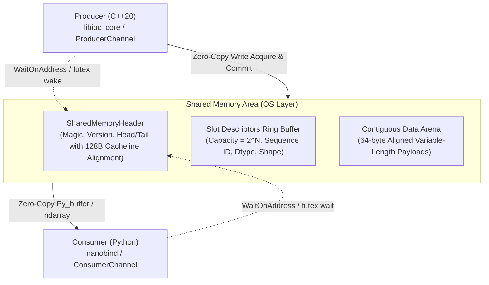

# zerocopy-ipc

Ultra-low-latency, zero-copy inter-process communication (IPC) library bridging C++20 and Python (NumPy / PyTorch) over shared memory.



## Key Architectural Guarantees

- **True Zero-Copy**: Consumer obtains direct pointers into shared memory exposed as native `numpy.ndarray` (`__array_interface__`) or `torch.Tensor` without intermediate serialization, copying, or pickle overhead.
- **Lock-Free SPSC Ring Buffer**: Single-Producer Single-Consumer ring with cacheline isolation (`alignas(128)`) eliminating false sharing between reader and writer cores.
- **Adaptive Hybrid Wait**: Fast spin-wait loop with CPU pause instruction (`_mm_pause`) for sub-microsecond latency, backing off to kernel primitives (`WaitOnAddress` on Windows, `futex` on Linux) to prevent CPU hogging on idle streams.
- **Safe Memory Lifetime**: Context-managed frame leasing (`with consumer.receive() as frame:`). The slot tail advances strictly upon context block exit, ensuring memory remains untouched while computing on the tensor.

---

## Performance Benchmarks

Measured on Windows 11 (AMD Ryzen / Intel Core):

### 1. 1080p RGB Video Streaming (6.22 MB / frame)
| Mechanism | Frame Rate (FPS) | Bandwidth | Transfer Time (100 frames) | Speedup |
| :--- | :--- | :--- | :--- | :--- |
| `multiprocessing.Queue` | 139.7 FPS | 829.0 MB/s | 0.716 s | 1.0x (baseline) |
| `TCP loopback socket` | 190.1 FPS | 1,128.0 MB/s | 0.526 s | 1.4x |
| **`zero_copy_ipc` (nanobind)** | **3,189.3 FPS** | **18,921.0 MB/s (18.9 GB/s)** | **0.031 s** | **22.8x** |

### 2. C++ Round-Trip Latency (RTT Ping-Pong)
| Percentile | Latency |
| :--- | :--- |
| **p50** | **0.20 µs (200 ns)** |
| **p90** | **0.50 µs (500 ns)** |
| **p99** | **1.20 µs** |
| **p99.9** | **4.20 µs** |

### 3. Throughput by Message Size
| Payload Size | Messages / sec | Bandwidth |
| :--- | :--- | :--- |
| **64 B** | **1,670,000+ msg/s** | 102 MB/s |
| **1 KB** | **842,000 msg/s** | 823 MB/s |
| **1 MB** | **1,300 msg/s** | **1,296 MB/s** |

---

## Directory Structure

```
zerocopy-ipc/
  include/
    ipc/
      protocol.hpp        # Shared memory header, slot descriptors, alignment
      shm.hpp             # Cross-platform RAII shared memory abstraction
      ring_buffer.hpp     # Lock-free SPSC ring buffer with payload arena
      sync.hpp            # Adaptive spin-wait + WaitOnAddress/futex
  src/
    shm_win32.cpp         # Windows CreateFileMappingW & MapViewOfFile
    shm_posix.cpp         # Linux/POSIX shm_open & mmap
    sync_win32.cpp        # Windows WaitOnAddress & WakeByAddress
    sync_posix.cpp        # Linux futex wait & wake
  python/
    bindings.cpp          # nanobind module with zero-copy ndarray support
    zero_copy_ipc/
      __init__.py
      channel.py          # High-level ProducerChannel & ConsumerChannel API
  benchmarks/
    bench_cpp.cpp         # C++ latency and throughput benchmark
    bench_comparison.py   # Python comparison against multiprocessing.Queue
  tests/
    test_ring_buffer.cpp  # C++ lock-free stress and wraparound tests
    test_python_api.py    # Python zero-copy & multi-process test suite
  CMakeLists.txt
  pyproject.toml
  README.md
  .gitignore
```

---

## Toolchain Prerequisites

- **C++ Compiler**: C++20 compliant compiler (MSVC 2022+ / GCC 11+ / Clang 13+)
- **Build System**: CMake >= 3.20
- **Python**: Python >= 3.9, `nanobind >= 2.0.0`, `scikit-build-core >= 0.10.0`, `numpy >= 1.22`

---

## Installation & Build

### 1. Build & Install via pip
```bash
pip install -e . --no-build-isolation
```

### 2. Standalone C++ Build
```bash
cmake -B build -S . -DCMAKE_BUILD_TYPE=Release -DBUILD_TESTS=ON -DBUILD_BENCHMARKS=ON
cmake --build build --config Release
```

### 3. Run C++ Unit Tests
```bash
ctest --test-dir build -C Release --output-on-failure
```

---

## Python Usage Example

### Producer (Sending NumPy Arrays or PyTorch Tensors)
```python
import numpy as np
from zero_copy_ipc import ProducerChannel

with ProducerChannel("my_channel", ring_capacity=64, data_arena_capacity=64 * 1024 * 1024) as prod:
    # 1080p RGB frame
    frame = np.random.randint(0, 256, (1080, 1920, 3), dtype=np.uint8)
    prod.send_tensor(frame)
```

### Consumer (Zero-Copy Frame Processing)
```python
from zero_copy_ipc import ConsumerChannel

with ConsumerChannel("my_channel") as cons:
    while True:
        with cons.receive(timeout_ms=1000) as frame:
            if frame is None:
                continue
            # Zero-copy NumPy view directly in shared memory
            arr = frame.to_numpy()
            print(f"Received frame {frame.sequence_id()}: shape={arr.shape}, dtype={arr.dtype}")
        # Tail pointer automatically advances upon context manager exit
```
